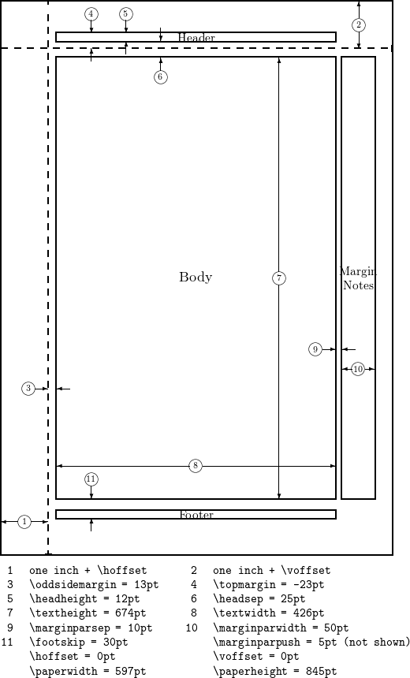

# MY Cheat Sheet
You can write LaTeX inline with single `$...$` or fenced blocks with `$$\n...\n$$`. Inline looks like $y = mx + b$, which is pretty slick-looking. In general, I'll use fenced blocks to illustrate the points.


# The Language Infrastructure
- install packages
    - open `MiKTeX Console` in admin mode


## LaTeX Document
- basic

    ```tex
    \documentclass{article}
    \usepackage{amsmath,amssymb,amsfonts,yhmath}
    \usepackage{url}
    \begin{document}

    You can write normal text, and then have the $\text{math },\; y=mx + b$ really pop.

    You can have access to url's inline as well like \url{https://google.com}{google.com}.

    \end{document}
    ```

- dimensions

    ```tex
    \documentclass{article}
    \usepackage{blindtext}
    \usepackage{geometry}
    \geometry{
        a4paper,
        total={170mm,257mm},
        left=20mm,
        top=20mm,}
    \begin{document}
    \section{Some dummy text}
    \blindtext[10]
    \end{document}
    ```

    - from [Overleaf](https://www.overleaf.com/learn/latex/Page_size_and_margins)

        


## Basic Syntax
- $% invisible comment$ - comment (invisible in presentation)
- $\text{visible comment}$ - comment (invisible in presentation)
- $X$ - math-y upper
- $\mathrm{X} \rm{X}$ - ascii upper in roman style non-italic
- $\rm X y z a b c D$ - remove math styling during this inline, doesnt behave well with blocks
- newline
    - $\text{newline} \\ \text{even within an inline}$
    - $A\newline{A}$
    - $A\\{A}$


## Spacing / Spaces
$$
hello \\
dudvdw \\
\,du\,dv\,dw \\
\ du\ dv\ dw \\
\url{https://tex.stackexchange.com/a/74354}{source} \\  % needs \usepackage{url}
\mathrm{newline} \newline
\text{also newline} \\
a~ b \\  % nbsp
a\, b  \\  % 3/18 of \quad (= 3 mu)
a\: b  \\  % 4/18 of \quad (= 4 mu)
a\; b  \\  % 5/18 of \quad (= 5 mu)
a\! b  \\  % -3/18 of \quad (= -3 mu)
a\  b  \\  % ? mu
a\space b \\  % no idea
a\quad b \\  % 18 mu
a\qquad b \\  % 36 mu
a\medspace b \\
a\negmedspace b \\
a\thickspace b \\
a\negthickspace b \\
a\hphantom{15}b \\
\rm{weird stuff happens with \backslash{rm} } \\
$$


## Text
- $``<quoted text here>"$ - quotation marks
- $n ~ \mathrm{n} ~ \text{n} $ - ascii lower, all 3 styles separated by nbsp non breaking space
- $\newpage$ - page break
- $\appendix$ - appendix, some renderers do not support this out of the box
- $\Phi ~ \phi$ - greek
- escape
    - $\backslash \$5.00 \# \% \& \~{a} \_ \^{b} \{ \} \$$ - escapes percent octothorp hashtag [via so](https://stackoverflow.com/a/5422751)
    - $\backslash$ backslash is not escapable, if you need it, you have to use the explicit `\backslash`


## Formatting / Alignment
- aligned
    $$
    \begin{aligned}
    \text{\& allows placement } & \text{of things} \\
    \text{double allows different } & \text{placement of } && \text{things} \\
    \text{like } & \text{this } && \text{and } &&& \text{that} \\
    \text{its all about the exact alignment of characters all lining up}
    \end{aligned}
    $$
- equation
    $$
    \text{allows numbered equations for references later} \\
    \begin{equation}
    y = mx + b
    \end{equation}
    $$
    $$
    \text{allows numbered equations for references later} \\
    \begin{equation}
    % \label{eu_eqn}  % no support for labels  % https://github.com/KaTeX/KaTeX/issues/2003
    \begin{split}
        A & = \frac{\pi r^2}{2} \\
        & = \frac{1}{2} \pi r^2
    \end{split}
    \end{equation}
    % The beautiful equation \ref{eu_eqn} is known as the Euler equation.  % or \ref  % https://github.com/KaTeX/KaTeX/issues/2003
    $$
- equation / formula definition alignment (numbering implicit)    TODO
    $$
    \begin{alignat}{7}
    10& x + &3 &y = 2 \\
    3& x + &13 &y = 4 \\
    &A &= &\text{has} \\
    &\neg{B} &= &\text{not has} \\
    &B &= &\text{test positive} \\
    &\neg{B} &= &\text{not test positive}
    \end{alignat}
    $$
- cases
    $$
    CE(p, y) =
        \begin{cases}
                -\log(p)            & \text{if } y = 1 \\    % & is your "\tab"-like command (it's a tab alignment character)
                -\log(1-p)        & \text{otherwise.} \\
                0        & \text{otherwise.} \\
        \end{cases}
    $$
- best alignment method I know (2 "columns", one aligned left, another aligned left starting center )
    $$
    \begin{aligned}
        & y = f(x) = \alpha \plusmn \beta{x}  && \text{after the double amps is all left aligned TO the center } \\
        & \text{text on left} && \text{text on right} \\
        & y = f(x) = \alpha \plusmn \beta{x}   \\
        \text{if you type here, you push things }  \\
        & && \text{empty on the left} \\
        & \text{empty on the right} &&  \\
    \end{aligned} \\
    $$
    > the reason you want to use "aligned" rather than "align*" is "align*" does something funk and declares a new "math space" in latex itself. so it renders correctly in vscode, but in pandoc conversions, pdflatex chokes.
    >
- previous best alignment method I know (2 "columns", one aligned left, another aligned left starting center )
    $$
    \begin{align*}
        & y = f(x) = \alpha \plusmn \beta{x}  && \text{after the double amps is all left aligned TO the center } \\
        & \text{text on left} && \text{text on right} \\
        & y = f(x) = \alpha \plusmn \beta{x}   \\
        \text{if you type here, you push things }  \\
        & && \text{empty on the left} \\
        & \text{empty on the right} &&  \\
    \end{align*} \\
    $$
- n-col
    $$
    \begin{align*}
        & \text{what happens} \\
        && \text{what happens} \\
        &&& \text{what happens} \\
        &&&& \text{what happens} \\
        % just one per line
        &&& \text{3} \\
        &&&& \text{4} \\
        && \text{2} \\
        & \text{1} \\
        % multi one per line out of order?
        & \text{1} && \text{2} &&& \text{3} &&&& \text{4} \\
        \text{0} \\
        & \text{1} &&&& \text{4} \\
    \end{align*}
    $$
- jank 3-col
    $$
    \begin{align*}
        \text{left but coming out of the center } & \text{the actual center } && \text{right from center} \\
        A                                        & B                        && C \\
    \end{align*} \\
    $$
- multiline center aligned
    $$
    \begin{aligned}
    p & = \hbar k \\
    E & = \hbar \omega \\
    \end{aligned}
    $$
- freeform alignment
    $$
    \begin{align*}
    A = 1 \\
    A = &1 \\
    A& = 1 \\
    A& = &1 \\
    &A= 1 \\
    &A &= 1 \\
    &A &= &1 \\
    \end{align*}
    $$


## Fonts
$$
A \\
\text{A} \\
\mathbf{A}  % bold face \\
\mathbb{A} \\
\mathcal{A}  % caligraphy \\
\mathit{A}  % italic \\
\mathbf {\text{note: } \backslash \text{ mathbf doesnt bold actual text }} \\
\mathcal{p} \text{ vs. } \mathbf{p} \text{ vs. } \text{p} \text{ vs. } p \\
\mathcal{P} \text{ vs. } \mathbf{P} \text{ vs. } \text{P} \text{ vs. } P \\
$$
- emphasis, bolding, italics, underlining
    $$
    \textbf{bold} \\
    \textit{italic} \\
    \emph{italic} \\
    \underline{bold} \\
    \underline{\textbf{\textit{combo}}}
    $$
- math fonts (Table 348 in [symbols-a4.pdf](./symbols-a4.pdf) or [by name](https://www.physicsread.com/latex-mathematical-font/))
    $$
    \begin{align*}
    3x^2 \in R \subset Q \\
    \mathrm{3x^2 \in R \subset Q}       & \quad \text{math roman} \\
    \mathbb{3x^2 \in R \subset Q}       & \quad \text{math blackboard} \\
    \mathbf{3x^2 \in R \subset Q}       & \quad \text{math boldface} \\
    \mathit{3x^2 \in R \subset Q}       & \quad \text{math italic} \\
    \mathsf{3x^2 \in R \subset Q}       & \quad \text{math san serif} \\
    \mathtt{3x^2 \in R \subset Q}       & \quad \text{math typewriter} \\
    % \mathds{3x^2 \in R \subset Q}       & \quad \text{math double stroke} \\
    \mathcal{3x^2 \in R \subset Q}      & \quad \text{math caligraphy} \\
    \mathscr{3x^2 \in R \subset Q}      & \quad \text{math RSFS (Ralph Smith's Formal Script)} \\
    % \mathrsfs{3x^2 \in R \subset Q}     & \quad \text{math Ralph Smith's Formal Script} \\
    \mathfrak{3x^2 \in R \subset Q}     & \quad \text{math Fraktur gothic} \\
    \mathnormal{3x^2 \in R \subset Q}   & \quad \text{math standard} \\
    \end{align*}
    $$
- horizontal lines, hr
    $$
    \rule{4cm}{0.4pt}\\
    \begin{aligned}
    1000 &\\
    + 2000 &\\
    \rule{1cm}{0.0pt} &\\
    30000 &\\
    \end{aligned}
    % must be in \documentclass{article}\begin{document}\end{document}...
    % https://tex.stackexchange.com/questions/19579/horizontal-line-spanning-the-entire-document-in-latex
    % https://thelinuxcode.com/latex-horizontal-line/
    Below is a Line spanning the entire width of the page
    \noindent\makebox[\linewidth]{\rule{\paperwidth}{0.4pt}}
    Below is a 2cm long line
    \noindent\rule{2cm}{0.4pt}
    Below is a 4cm long line
    \noindent\rule{4cm}{0.4pt}
    Below is a 8cm long line
    \noindent\rule{8cm}{0.4pt}
    \newcommand{\hr}{
        \begin{center}
            \line(1,0){450}
        \end{center}
    }
    $$
- multiline
    $$
    \substack{
        \mathbf{v}^\top  A\mathbf{v},\ A \text{ symmetric} \\
        (X^\top X)^\top  = X^\top X \\
        \text{put whatever you'd like here, lmao}
    } = 2
    $$
- overs:
    $$
    \bar{ABC} \\
    \overline{ABC} \\  % overbar
    \overrightarrow{ABC} \\
    \overrightarrow{\rm ABC} \\
    \overrightarrow{\text{ABC}} \\
    \overset{iid}{\sim} \\  % overtext
    \hat{ABC} \\
    \widehat{ABC} \\  % yhmath package required
    \tilde{ABC} \\
    $$
- unders:
    $$
    \begin{aligned}
    \underset{T \subseteq [n],\ \mid T \mid = P}{\argmax} \\
    \\
    \underbrace{\argmax}_{T \subseteq [n],\ \mid T \mid} \\
    \\
    \operatorname*{arg\,max}_{T \subseteq [n],\ \mid T \mid = P}^{lol} \\
    \end{aligned}
    $$
- scripts, prescript, postscript, underscript, superscript
    - ${}^{1}_{2}x^{3}_{4}$ - prescript - left and right subscript, a prescript if you will - https://tex.stackexchange.com/a/305700
    - $X_{(i + 1)}$ - subscript / underscript
    - $X^{(i + 1)}$ - superscript / upperscript
- displaystyle just means alternate display style
    $$
    a_0+{1\over a_1+
        {1\over a_2+
            {1 \over a_3 +
            {1 \over a_4}}}}
    $$
    > vs
    $$
    a_0+{1\over\displaystyle a_1+
        {1\over\displaystyle a_2+
            {1 \over\displaystyle a_3 +
            {1 \over\displaystyle a_4}}}}
    $$
    > vs
    $$
    \frac{1}{a_1 + \frac{1}{a_2 + \frac{1}{a_3 + \frac{1}{a_2}}}} \\
    \displaystyle\frac{1}{a_1 + \displaystyle\frac{1}{a_2 + \displaystyle\frac{1}{a_3 + \displaystyle\frac{1}{a_2}}}} \\
    \dfrac{1}{a_1 + \dfrac{1}{a_2 + \dfrac{1}{a_3 + \dfrac{1}{a_2}}}} \\
    $$


## Basic Symbols / Operators / Notation / Format / General / Display
- $\checkmark \times \sim \degree \boxed{6.9}$ - misc anything, check, x mark x-mark xbox x-box x box, cross, multiply, wide tilde, is distributed as, degrees, box around, boxed
- arithmetic
    - $+, -, \pm$ - plus, minus, plusminus
    - $\times, \cdot$ - times
    - $e^{2}, e^{\frac{1}{2}}$ - exponentiation
    - $1 + 2 - 3 * 4 /    5 ^ {(6)} \times 7 \cdot 8 \div \pm \plusmn$ - pemdas plus minus
- fractions:
    - $\frac{1 + 1}{n - 1}$
    - $\dfrac{1 + 1}{n - 1}$
    - $1 + 1 \over n - 1$
- $\sqrt{4i}, \sqrt[3]{4i}, \sqrt[n]{4i}, e^{-\frac{1}{2}}$ - roots
- $\log(10) \qquad \log_{10}(10) \qquad \log_{(e+1)}(10) \qquad \ln(e)$ - logs
- $\dots, \cdots, \vdots, \ddots$ - dot dot dot, elipses
- $\inf \infty \R $ - symbols infinity, sets, negate, iff if only if congruence, elipses, dots, vector
- [big braces big brackets](https://tex.stackexchange.com/a/38870)
    $$
    (   \big(   \Big(   \bigg(  \Bigg(  \Bigg)  \bigg)  \Big)   \big)   ) \\
    [   \big[   \Big[   \bigg[  \Bigg[  \Bigg]  \bigg]  \Big]   \big]   ] \\
    \{  \big\{  \Big\{  \bigg\{ \Bigg\{ \Bigg\} \bigg\} \Big\}  \big\} \} \\
    $$


## Functions
- $\operatorname{function-Name-Anything}(x, y, z)$ - user-defined function
    $$
    % maps to or rightarrow
    \operatorname{floor}: \mathbb{R} \mapsto \mathbb{Z}\\
    \operatorname{floor}: \mathbb{R} \rightarrow \mathbb{Z}\\
    \operatorname{floor}: \mathbb{R} \to \mathbb{Z}\\
    $$
- function display styles
    $$
    % WARNING: regular pipe doesnt work within sum, must be \vert or \Vert
    \displaystyle\sum^{n}_{k=1} x^k, \vert x \vert \\
    Var(aX + b) = a^2Var(X) \\
    \text{Var}(aX + b) = a^2\text{Var}(X) \\
    \operatorname{Var}(aX + b) = a^2\operatorname{Var}(X) \\
    $$
- $f \circ g; f \bullet g$ - composition
- $\lceil h \rceil, \lfloor h \rfloor$ - floor / ceil
- abs, pipe, norms
    - $| \text{actual pipes dont play well with markdown... fine for pure latex} |$
    - $\vert \operatorname{abs} \vert$
    - $\mid \operatorname{abs} \quad$
    - $\Vert \text{norm} \Vert$
        - $\Vert \text{norm} \Vert_{1}$
        - $\Vert \text{norm} \Vert_{2}$
- proportional $\propto$


## Constants / Symbols
- $e, \pi$ - constants
- $i, j, \imath, \jmath$ - imaginary
- $\pounds$ - British Pounds


## Geometry / Trigonometry
- $\parallel, \not\parallel$ - parallel / not-parallel
- $\perp, \bot, \not\perp, \top$ - perpendicular / not-perpendicular
- $\cong, \angle, \triangle$
- $\sin(\theta), \arccos(\theta), \arctan(\theta), \cosh(\theta)$


## Algebra
- absolute value: $\vert -69 \vert = 69$
- summation
    - $\sum_{i=1}^n$ - sum small
    - $\displaystyle\sum_{i=1}^{n}( \bar{a} + \hat{b}^{i}_{i} )$ - sum big
- product
    - $\prod_{i=1}^{n}$ - product small
    - $\displaystyle\prod_{i=1}^n$ - product big


# Boolean Algebra / Logic / Set Theory
- $\neq, \leq, \geq \equiv, \approx, \thickapprox, \cong, \simeq, \sim$ - [comparators](https://www.geeksforgeeks.org/relational-operators-in-latex/) - not equal, less than or equal, greater than or equal, almost equal, ~=, sort of equal, sortof, semi-equal, semi equal, congruence, similar, etc.
- $\not \quad \not\geq \quad \not\parallel \quad \not\neq$ - useful to convert a bunch of stuff to the opposite symbol, regardless of sense
- $\propto$ - proportional
- [logic](https://en.wikipedia.org/wiki/List_of_logic_symbols)
    - $\neg, \lnot, \lor, \land, \oplus, \otimes$ - operators
    - $\exists, \nexists, \forall, \implies, \to, \rightarrow, \leftrightarrow, \iff, \equiv$ - if and only if - sayings
    - $\veebar, \vee, \longrightarrow, \Rightarrow , \Longrightarrow, \leftarrow, \longleftarrow, \Leftarrow, \Longleftarrow, \leftrightarrow, \Leftrightarrow, \longleftrightarrow, \Longleftrightarrow$ - misc
    - $\Rightarrow, \Leftarrow$ - contradiction
- [set](???)
    - $\cup, \cap, \subset, \subseteq, \supset$ - operators:union, intersection, proper subset, subset, superset
    - ${\rm A \subseteq B}$ - use rm to make bold face
    - sets:
        - $\emptyset$ - empty set or null set
        - $\mathfrak{P}(S), \wp(S)$ - power set
        - $\overline{A}, A^\prime, A^\complement$ - complements
    - $\forall, \exists, \not\forall, \not\exists$ - universalism, existentialism
    - $\in, \notin$ - sayings / isms
- forall
    - $\displaystyle\bigwedge_{i=1}^n  \displaystyle\bigvee_{i=1}^n$ - forall set conjunction, disjunction
    - $\displaystyle\bigcup_{i=1}^n  \displaystyle\bigcap_{i=1}^n  \displaystyle\bigoplus_{i=1}^n$ - forall set union, disunion, exclusivity


## Probability
- conditional probability: $p(A \mid B) = \dfrac{p(B \mid A) \cdot p(A)}{p(B)}$


## Statistics
- $\bar{X} \hat{X}$ - X-bar, X-hat
- $\mathcal{N}$ - Normal Distribution
- "is modeled as" $X \sim \mathcal{N}(\mu, \sigma^2)$
- iid (independent, identically distributed): $X_1, X_2, \cdots X_n \overset{\mathrm{iid}}{\sim} \mathcal{N}(\mu, \sigma^2) \rightarrow \bar{X} \sim \mathcal{N}(\mu, \frac{\sigma^2}{n})$


## Calculus
- derivatives:
    - $x', x^{\prime}$ - prime
    - $x'', x^{\prime\prime}$ - double prime
    - $\frac{\partial}{\partial x}$ - partial derivative, del
    - $\nabla$ - gradient
    - $\lim_{x \to \infty} f(x), \displaystyle\lim_{x \to \infty} f(x)$ - limit
- integration
    - $\iiint^{E}_{V} \mu(u,v,w) \,du\,dv\,dw$ - integrals
    - $\displaystyle\iint^{10}_{13} \frac{\partial{x}}{\partial{y}}$ - double integral
    - $\displaystyle\int_{a}^{b}$ - integral
    - $\displaystyle\oint_{a}^{b}$ - integral with a spicy hoop
    - $\bigg\vert_{a}^{b}$ - evaluation over an interval


## Linear Algebra
- $\mathbf{M}^T, \mathbf{M}^{\intercal}, \mathbf{M}^{\top}$ - matrix transpose
- vector
    $$
    \overrightarrow{v} = \overset{\rightarrow}{\mathbf{v}} = \vec{v} = v = \left[\begin{array}{rrr} 1 & 1 & 2 & 1 \end{array}\right]
    \\
    \overrightarrow{vector} = \overset{\rightarrow}{\mathbf{vector}} = \vec{vector} = vector = \left[\begin{array}{rrr} 1 & 1 & 2 & 1 \end{array}\right]
    $$
- array / matrix, note boldface matrix symbol
    - **NOTE:** DO NOT USE ARRAY, it doesnt work well unless parameterized with the alignment. just use bmatrix for simplicity
        $$
        \mathbf{A}_{2\times2} = \left[
            {
                \begin{array}
                    {cc}
                    a_{11} & a_{12} \\
                    a_{21} & a_{22} \\
                    a_{31} & a_{32} \\
                \end{array}
            }
        \right]
        $$
    - bmatrix bracketed with array equivalent
        $$
        (X'X)^{-1} = \begin{bmatrix}
        0.893758 & -0.0282448 & -0.0175641 \\
        -0.0282448 & 0.0013329 & 0.0001547 \\
        -0.0175641 & 0.0001547 & 0.0009108
        \end{bmatrix} = \left[ \begin{array}
        {rrr}
        0.893758 & -0.0282448 & -0.0175641 \\
        -0.0282448 & 0.0013329 & 0.0001547 \\
        -0.0175641 & 0.0001547 & 0.0009108
        \end{array} \right]
        $$
    - pmatrix / parenthetical matrix, note boldface matrix symbol
        $$
        \mathbf{A}_{2\times2} =
            {
                \begin{pmatrix}
                    a_{11} & a_{12} & a_{13} & a_{14} \\
                    a_{21} & a_{22} & a_{23} & a_{24} \\
                    a_{31} & a_{32} & a_{33} & a_{34} \\
                    a_{41} & a_{42} & a_{43} & a_{44} \\
                    a_{51} & a_{52} & a_{53} & a_{54} \\
                \end{pmatrix}
            }
        $$
    - augmented matrix
        $$
        \left[\begin{array}{rrr|c}
        1&1&2&1\\
        2&-1&-1&2\\
        -1&1&-1&0
        \end{array}\right]
        $$
    - big matrix from https://latex-tutorial.com/ellipses-in-latex/, note boldface matrix symbol
        $$
        \mathbf{A} = \begin{bmatrix}
        -10 & -20 & 15 & 20 & -15 & -20 \\
        22 & -10 & \cdots & \cdots & -10 & -15 \\
        -11 & -10 & \cdots & \cdots & -10 & -10 \\
        -10 & -10 & \cdots & \cdots & -10 & -10 \\
        \vdots & \vdots & \ddots & & \vdots & \vdots \\
        \vdots & \vdots & & \ddots & \vdots & \vdots \\
        -10 & 10 & \cdots & \cdots & -10 & -10 \\
        -10 & 10 & \cdots & \cdots & -10 & -10 \\
        11 & 10 & \cdots & \cdots & -10 & -20 \\
        -20 & -11 & -10 & -1 & -20 & -10
        \end{bmatrix}
        $$
    - gaussian elimination, swap, scale, eliminate, augmented matrices
        $$
        \left[\begin{array}{cccc|c}
        1 & 2 & -1 & 3 & 4\\
        2 & 4 & -1 & 8 & 11\\
        -1 & -2 & 2 & -1 & -1
        \end{array}\right]
        \xrightarrow{\substack{R_2 \leftarrow R_2 - 2R_1\\ R_3 \leftarrow R_3 + R_1}}
        \left[\begin{array}{cccc|c}
        1 & 2 & -1 & 3 & 4\\
        0 & 0 & 1 & 2 & 3\\
        0 & 0 & 1 & 2 & 3
        \end{array}\right]
        \xrightarrow{R_3 - R_2}
        \left[\begin{array}{cccc|c}
        1 & 2 & -1 & 3 & 4\\
        0 & 0 & 1 & 2 & 3\\
        0 & 0 & 0 & 0 & 0
        \end{array}\right]
        $$
- more
    - $\ell(1)$ - the diagonal/length, etc.
    - $\vdots \cdots \ddots$ - elipses
    - $\mathcal{U}, \mathcal{V}, \mathcal{W}$ - subspaces

## Number Theory
- $\mid \nmid a \bmod b, a \mod b, a \pmod b, a \pod b, a \operatorname{div} b \equiv a \bmod c$ - divides / indivisible / modulo
- combinatorics / binomial
    $$
    \binom{a}{b}
    $$
- number sets
    $$
    \begin{aligned}
    \mathbb{U} & \text{ - universal}      \\
    \mathbb{P} & \text{ - prime}      \\
    \mathbb{W} & \text{ - whole}      \\
    \mathbb{N} & \text{ - natural}        \\
    \mathbb{Z} & \text{ - integers}       \\
    \mathbb{I} & \text{ - irrational}     \\
    \mathbb{Q} & \text{ - rational}       \\
    \mathbb{R} & \text{ - real}       \\
    \mathbb{C} & \text{ - complex}        \\
    \mathbb{H} & \text{ - quaternions}        \\
    \mathbb{O} & \text{ - octonions}      \\
    \mathbb{S} & \text{ - sedenions}      \\
    \end{aligned}
    $$

# Cross-Discipline Summaries

## Machine Learning - Statistics + Linear Algebra
- $\mathcal{F} \mathscr{F}$ - sigmoid function or sigma field
- $\nabla$ - gradient
- $\hat{\imath} \hat{\jmath}$ - unit vectors (i and j without the dots):
    - $\vec{\rm v} ~ \overrightarrow{vabd}$ - vector
    - $\operatorname{span}\{\mathbf{v}_1, \mathbf{v}_2, \ldots, \mathbf{v}_n\}$ - [vector spaces](https://www.underleaf.ai/learn/latex/vector-spaces)


## Proofs
- jank, looks ok:
    $$
    \begin{aligned}
    \text{let } p &: \text{it is hotter than 100} \degree \text{ today.} \\
                q &: \text{the pollution is dangerous.} \\
    \\
    & p \lor q \\
    & \lnot p \\
    \hline
    & \blacksquare q \\  % QED, qed
    & \therefore q \\
    \end{aligned}
    $$


## Diagrams
- diagram
    $$
    \begin{CD}
    A @>a>> B \\
    @VbVV @AAcA \\
    C @= D
    \end{CD}
    $$


# Tips n Tricks n Hacks

## Tips
- markdown with latex

    | header | header |
    | --- | --- |
    | $\Rho(A\|B)$ | $\text{escapes usually work well in this area}$ |

- note the different indentation rules

## Hacks
- permutation/combination: ${}_{n}P_{r}, {}_{n}C_{r}$


# "Official" Docs or Cheatsheets
- reference: [Comprehensive TeX Archive Network](https://ctan.org/) and a [directory](https://tug.ctan.org/) to file browse, check out even [info](https://tug.ctan.org/info/) for bunch of random stuff
- cheat sheets
    - https://katex.org/docs/supported.html
    - [Every friggen symbol](https://tug.ctan.org/info/symbols/comprehensive/symbols-a4.pdf)
    - [symbols in a wiki but its incomplete](https://oeis.org/wiki/List_of_LaTeX_mathematical_symbols)
    - [overleaf version](https://assets.ctfassets.net/nrgyaltdicpt/4e825etqMUW8vTF8drfRbw/d4f3d9adcb2980b80818f788e36316b2/A_quick_guide_to_LaTeX__Overleaf_version.pdf)
    - [LaTeX2e: An unofficial reference manual](https://latexref.xyz/Math-symbols.html)
    - [2005 Symbols](https://sites.math.washington.edu/~reu/docs/latex_symbols.pdf)
- issues / bugs
    - https://github.com/KaTeX/KaTeX/issues/2003
- guides / courses
    - [lshort--the bible](https://www.ctan.org/tex-archive/info/lshort/) for lots of lanugages which end up hosting [pdfs like this](https://mirror.las.iastate.edu/tex-archive/info/lshort/english/lshort.pdf)
    - [overleaf intro guide, see left hand side](https://www.overleaf.com/learn/latex/Learn_LaTeX_in_30_minutes) but dont pay for it
    - [Interactive Website Guide](https://latexguide.org/book-contents/chapter-09-writing-math-formulas/)
    - [Another interactive guide](https://colinsauze.github.io/introduction-to-latex/07-equations/index.html)
- really cool websites
    - [draw and get a symbol](https://detexify.kirelabs.org/classify.html)
